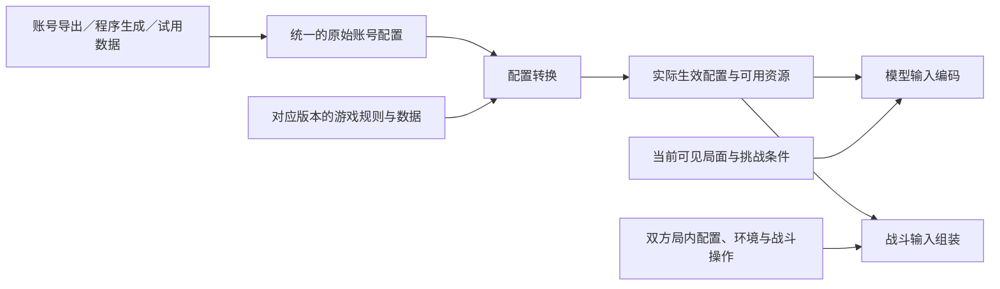

# 账号与遗器数据

状态：设计草案。日期：2026-11-10。本文约定首轮开发范围；数据格式、生成器和转换程序均待实现。

## 数据流与职责

账号导出、程序生成和试用数据使用同一条处理流程：

数据接入负责外部字段和单位转换，账号生成器负责按条件产生配置；配置转换负责查询游戏数据、应用游戏内强制映射并解析属性和机制配置。模型输入编码使用转换结果和当前可见信息，战斗输入组装结合局内星级、装备、敌人及环境效果。两端引用同一份生效配置及版本。技能效果和触发顺序由战斗引擎执行。

游戏基础数据、来源核对记录和生成的训练样本保存在私有仓库 `hsr-currency-wars-data`，生成与转换代码在本仓库维护。条目使用数据快照、类别和 ID 关联；训练批次保存所用数据版本，支持后续复现。

账号资源保留可用的本体、试用和装备实例，以及它们的使用限制。策略模块在这些资源中选择阵容、分配装备，环境检查操作是否合法。

## 原始配置保存什么

| 对象 | 首轮需要表达的内容 |
| --- | --- |
| 角色 | 角色 ID、形态、本体或试用来源、星魂数，以及转换所需的原始等级信息 |
| 行迹 | 普攻、战技、终结技和天赋的基础等级，以及已解锁的额外能力和属性节点 ID |
| 光锥 | 光锥 ID、叠影，以及转换所需的等级信息；可分配的光锥用实例 ID 区分 |
| 遗器实例 | 实例 ID、套装 ID、部位、品质、强化等级、主词条 ID、副词条属性 ID 与数值 |
| 装备关系 | 配置引用的光锥、遗器实例 ID，用于识别归属和检查重复占用 |
| 复现信息 | 配置 ID、格式版本、游戏数据快照、规则版本；生成样本另记生成器版本、参数和随机种子 |

等级字段是否还需要突破阶段等信息，由首个转换样例核对。行迹记录基础等级，星魂附加等级由转换程序按规则处理。角色、光锥和套装的具体数值与机制通过 ID 查询对应数据。

原始配置保留来源记录。练度不足时，转换程序按[游戏规则](game-rules.md)应用默认配置，输出局内实际生效的等级、行迹、属性和机制引用。各字段的触发条件、默认值和替换范围先用实测样例核对，再进入规则数据。必需数据缺失时报告具体缺项。

同一种生效配置可以关联多份来源配置；训练时按映射后的差异采样，同时保留来源和资源约束。全试用任务使用实际试用配置，并由环境限制可选来源。

## 遗器怎样生成

首轮从一套六件遗器开始，固定随机种子，按外部规则数据生成实例。规则数据需要注明版本和验证状态，至少包含：

- 各部位允许的主词条、品质与强化等级范围、主词条成长表。
- 副词条池、与主词条的排斥关系、初始词条数量、强化次数和数值档位。
- 本次生成所用的属性、档位与强化目标采样分布。

先采样部位与主词条，再生成初始副词条，按强化过程分配新增词条和提升次数。输出副词条数值，并保留本次采样记录以便核对。主词条数值由转换程序查表取得；比例属性的单位在格式中明确，接入层负责来源单位换算。

生成目标可以限制平均词条水平、属性倾向和角色之间的资源分布。生成后核对实际指标是否落在目标范围；约束无法满足时返回具体原因。普通搭配、合理搭配和有明显短板的搭配都保留样本，供不同训练阶段使用。

## 账号怎样评价与按条件生成

资源指标用于描述投入和控制生成条件，对局成绩用于估计账号在指定测试条件下的能力。第一版分别保存以下指标：

| 指标 | 统计约定 |
| --- | --- |
| 金数 | 五星角色本体与星魂、五星光锥及叠影对应的份数，限定与常驻分别统计；试用资源单独记录 |
| 遗器词条水平 | 记录初始词条、强化次数和档位的分布；有效词条按指定角色或打法及标准档位折算，注明计算口径 |
| 资源集中程度 | 记录各角色配置的投入分布，区分资源集中与分散的账号 |

遗器平均值同时注明统计范围，例如账号库存或选定角色的六件套。速度、充能等关键属性单独保留，支持后续检查阈值和搭配关系。有效词条权重、标准档位和资源集中程度的计算方式在样例阶段确定并记录版本。

按条件生成账号时，先指定金数和遗器指标范围、角色范围及资源分布，再分配星魂、光锥和遗器。生成后执行配置转换，记录原始资源指标与生效配置标识。模型主要练习映射后仍有差异的配置。

模拟接通后，在固定场景、策略和计算预算下报告通关率、SSS 率及不同打法的表现，并附样本量。模型更新时记录评价策略版本，便于区分策略改进和账号资源差异。训练与评估按账号配置及整局划分，保留未参与训练的账号和组合。

## 首个样例与完成条件

当前先交付一个角色、一个光锥和六件遗器的输入输出样例：

1. 从已有游戏资料中选择条目，记录数据快照、规则依据和待核对字段。
2. 写出原始配置与装备实例，明确 ID、单位、等级及行迹的口径。
3. 给出固定种子的遗器生成参数、生成结果和资源指标。
4. 给出该配置按游戏规则转换后的预期结果，覆盖练度不足的映射情况和实际试用配置。
5. 与战斗侧核对生效配置的读取方式，与运营侧核对可用资源、装备关系及合法操作所需字段。

完成时应能复现遗器结果，检查主副词条及强化是否合法，并追溯生效配置使用的规则。账号数据任务可先核对转换结果；战斗和运营接入后，再分别补充数值对照与节点联调结果。具体任务安排见[实施阶段与任务拆解](implementation-plan.md)。
