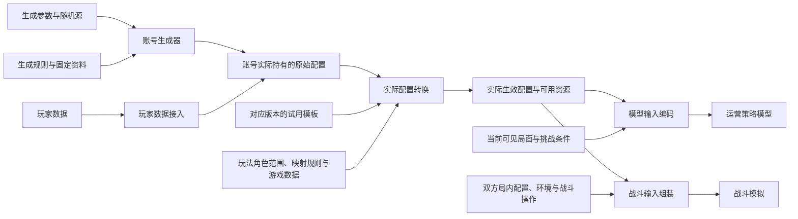

# 账号数据流与模块职责

状态：设计约定。持有角色的原始配置及单件和六件遗器生成已实现；账号级金数、统一五星配装和集中分配已实现；玩家数据接入和实际配置转换待实现。本文用于对接账号生成、模型输入和战斗模拟。

## 处理流程

程序生成与玩家数据接入提供账号实际持有的角色、光锥、遗器和装备关系。后续配置转换按角色 ID 为未持有角色补齐试用，再应用游戏规则，输出实际生效配置及可用资源，供模型与战斗侧共用。

## 各模块交付什么

| 模块 | 接收 | 交付 |
| --- | --- | --- |
| 账号生成器 | 持有人数、金数或统一五星配装、遗器指标、投入分布和随机源 | 持有角色、光锥、遗器及装备关系，附生成规则版本与实际资源指标 |
| 玩家数据接入 | 玩家提供的数据 | 字段和单位统一后的持有资源与原始配置 |
| 配置转换 | 原始配置、试用模板、玩法角色范围及对应版本的游戏规则 | 按持有情况补齐角色后，实际生效的等级、行迹、属性、机制引用和可用资源 |
| 模型输入编码 | 生效配置、可见局面及挑战条件 | 模型使用的结构化输入 |
| 战斗输入组装 | 生效配置、局内星级与装备、双方状态和环境 | 战斗模拟所需输入 |

账号生成器位于 `research/account_generation/`，供研究和训练调用。玩家数据接入独立开发。完整角色和遗器生成通过 Python 参数调用，当前入口见[账号数据生成](account-generation.md)、[完整角色配置生成](character-generation.md)与[单件遗器生成与评分](relic-generation.md)。

## 生成与实际配置的分工

| 阶段 | 处理内容 |
| --- | --- |
| 原始数据生成 | 选择持有角色与装备，光锥留空时按同命途推荐选择、显式指定时直接采用，生成原始等级、星魂、行迹基础等级、叠影和遗器数值，建立装备引用 |
| 实际配置转换 | 按持有列表补齐试用，应用练度保底映射、星魂附加等级、角色与装备的属性和效果 |
| 局内流程与战斗组装 | 选择货币战争形态，加入局内星级、站位、局内装备和环境，组装战斗输入 |

原始账号用角色条目是否存在表达持有情况。缺席角色在实际配置阶段采用试用模板；生成器返回的每个角色都是持有条目。原始字段见[数据设计](design.md#原始配置保存什么)。

生成行迹时按角色的原始等级、突破阶段与前置条件选择可用基础等级。配置转换再执行游戏内强制映射，包括等级 80 和对应行迹等级保底；触发条件、默认配置和替换范围在[游戏规则](../../project/game-rules.md)中维护。

模型与战斗模拟读取同一份生效配置。模型编码再加入可见局面与挑战条件；战斗组装再加入敌人、局内星级和环境。技能触发和行动结算由战斗引擎执行。

## 资源与版本怎样传递

账号原始配置保存持有资源及装备引用。实际配置转换补齐试用后，输出本体与试用的使用限制，供后续选择资源和检查操作使用。全试用挑战由实际配置与挑战流程采用对应版本的试用模板。

调用方记录账号生成请求与随机种子，生成结果记录生成规则版本。原始配置与生效配置通过配置标识关联，并引用相同的数据快照。两个下游使用同一次转换结果，便于复现模型决策和战斗计算。

完整账号样例的交付条件见[首个样例与完成条件](design.md#首个样例与完成条件)。
