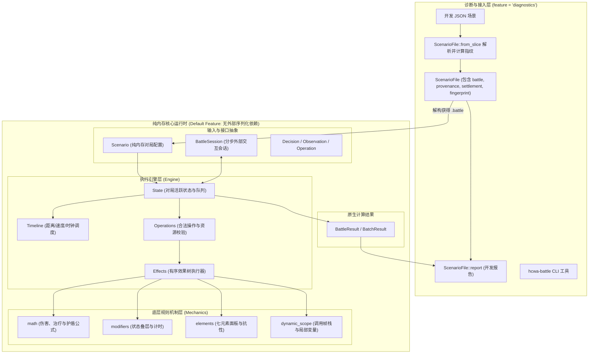
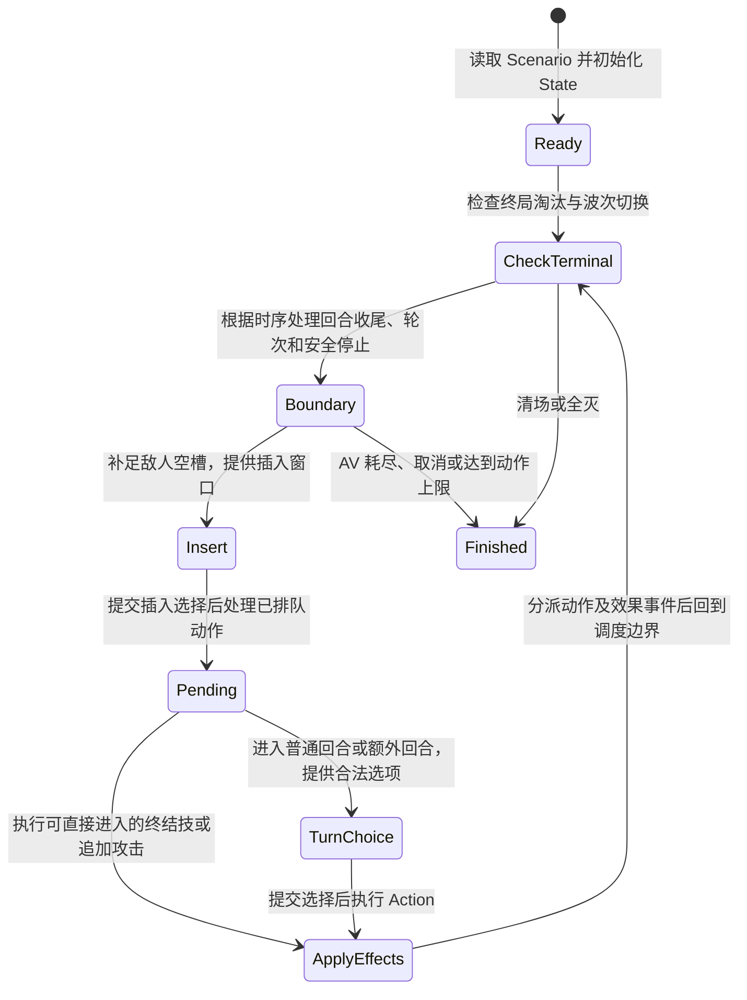

# 战斗模拟架构与逻辑设计

本文档阐述 `core/battle` 战斗模拟核心的设计架构、核心运行时与诊断分离机制、时序调度算法以及伤害与效果计算管线。

---

## 1. 架构分层与双层设计 (Runtime vs. Diagnostics)

`battle-core` 遵循单向依赖与职责明确的分层设计，并在架构上实现了**纯内存轻量运行时 (Core Runtime)** 与**诊断及序列化系统 (Diagnostics)** 的解耦：

### 1.1 运行时与诊断

- **运行时**接收组装好的 `Scenario`，直接推进战斗。组装方保证静态配置和规则引用有效，引擎检查当前动作是否合法、资源是否充足及动态数值是否有效。
- **诊断构建（`diagnostics`）**启用 `serde` 和 `serde_json`，为开发工具提供 JSON 场景解析、输入指纹和回放导出。命令行工具 `hcwa-battle` 与示例 `step_battle` 均使用此特性。

### 1.2 模块职责划分

| 模块目录 | 相对路径 / 命名空间 | 核心职责 |
| --- | --- | --- |
| `src/model/` | [`battle_core::model`](../../../core/battle/src/model/mod.rs) | 纯数据结构定义。包含对局场景配置、单位、动作定义、事件类型及原生结果模型。在 `diagnostics` 特性下提供 Serde 序列化标注。 |
| `src/engine/` | [`battle_core::engine`](../../../core/battle/src/engine/mod.rs) | 战斗执行主循环与状态维护。包含会话状态机、单位队列管理、行动时序推进、动作派发与目标选择。 |
| `src/mechanics/` | [`battle_core::mechanics`](../../../core/battle/src/mechanics/mod.rs) | 无状态或局部状态的通用数学计算与规则子系统。包含多乘区伤害算式、属性状态叠层、七元素属性与表达式求值。 |
| `src/decision.rs` | [`battle_core::decision`](../../../core/battle/src/decision.rs) | 外部决策与策略抽象。提供局面观测快照、合法动作空间定义及策略 Trait。 |
| `src/batch.rs` | [`battle_core::batch`](../../../core/battle/src/batch.rs) | 蒙特卡洛多局批次运行器，管理独立随机种子派生与胜率统计评估。 |
| `src/diagnostics/` | [`battle_core::diagnostics`](../../../core/battle/src/diagnostics/mod.rs) | 解析开发场景（`ScenarioFile`），生成回放和开发报告（`BattleReport`）。 |

---

## 2. 核心执行流程与时序调度

单场战斗由 [`BattleSession`](../../../core/battle/src/engine/session.rs) 驱动。引擎主循环执行以下关键阶段：

### 2.1 行动距离与时间推进算法

行动轴基于经典“行动距离 / 当前速度”模型推进，调度规则严格保证确定性：

1. **基本单位**：每个存活单位持有 `remaining_distance`（初始基础值为 10,000）和当前速度 `speed`。
2. **行动等待时间（Action Value, AV）**：
   $$\Delta \text{AV} = \frac{\text{remaining\_distance}}{\text{speed}}$$
3. **时间步推进**：
   - 选取所有存活单位中等待时间最小的单位，其等待时间为步长 $\Delta t$。
   - 所有存活单位的行动距离同步扣减：
     $$\text{remaining\_distance} \leftarrow \text{remaining\_distance} - \Delta t \times \text{speed}$$
   - 全局已流逝时间累计 $\text{now} \leftarrow \text{now} + \Delta t$。
4. **变速与拉条规则**：
   - **动态变速**：修改当前速度 `speed` 时，单位已推进到的 `remaining_distance` 保持不变，仅更新后续等待时间。
   - **行动提前 / 推条**：`advance` 修改当前距离，普通回合中的执行者除外。`advance_next` 记录下次重置距离时的偏移。
   - 普通回合结束时，引擎分派 `TurnEnd`，再按基础距离和已登记的下次提前量重置该单位的距离。

### 2.2 插入动作与回合优先级

行动窗口按照以下层级调度：

- **终结技插入（Ultimate）**：可在常规回合动作的间隔插入。提交插入仅表示预排队；在终结技实际获得执行权切入 Turn 时，引擎再次校验能量并正式扣除费用。
- **追加攻击（Follow-up）**：作为直接 Action 执行，不产生独立的 `TurnStart` 与 `TurnEnd` 回合边界。
- **额外回合（Extra Turn）**：在独立回合开始（`TurnStart`）后发起选招，不推进自然 AV 时钟。
- **同刻平局判定**：当单位行动与 Cycle 到期发生同刻时，支持通过显式策略参数 `unit_before_cycle` 控制优先处理单位回合还是优先倒计时。

---

## 3. 伤害与数值结算 (Damage Pipeline)

每次攻击命中的数值计算均在确定性规则下执行，完整结算流程如下：

### 3.1 直接伤害公式

每次命中（Hit）的理论伤害计算公式如下：

$$\text{Damage} = \text{Base} \times (1 + \text{DmgBonus}) \times \text{Independent} \times \text{DefMult} \times \text{ResMult} \times \text{BrokenMult} \times (1 + \text{Vulnerability}) \times \text{CritMult} \times (1 - \text{DmgReduction}) \times \text{Factor}$$

1. **基础数值 (Base)**：由攻击者面板（攻击力、防御力或生命上限比例）结合动作配置确定。
2. **增伤乘区 (DmgBonus)**：全局增伤与当前命中对应元素的属性增伤之和，加上实时活动的 Modifier 增益。
   - 引擎要求合计增伤 `damage_bonus >= -1.0`、合计暴击伤害加成 `crit_damage >= 0.0`。
3. **易伤乘区 (Vulnerability)**：受击者身上的易伤状态总和。
4. **防御乘区 (DefMult)**：
   $$\text{DefMult} = \frac{10 \times \text{level} + 200}{10 \times \text{level} + 200 + \text{defense} \times \max(0, 1 - \text{defense\_reduction} - \text{defense\_ignore})}$$
5. **抗性乘区 (ResMult)**：将目标抗性减去攻击方抗性穿透，约束到 $[-1.0, 0.9]$ 后以 1 减去所得值。
6. **击破状态乘区 (BrokenMult)**：按输入面板的 `toughness_broken` 取 1.0 或 0.9。韧性扣减和 `Break` 事件由对应效果处理。
7. **独立乘区、暴击和减伤**：独立乘区直接使用攻击方面板的 `independent_multiplier`。暴击时乘以 `1 + crit_damage`，其余命中取 1。减伤乘区取 `1 - damage_reduction`。
8. **我方伤害系数 (Factor)**：我方单位造成直接伤害时应用 `mechanics.ally_damage_factor`，默认值为 1.0，敌方单位造成伤害时取 1。

### 3.2 护盾吸收与生命扣减

- 计算出的实际伤害优先扣减受击者当前持有的 `shield`。
- 护盾不足或耗尽时，超出部分的伤害扣减 `current_hp`。
- 命中使目标生命归零时，引擎在分派 `Hit` 后处理死亡及复活。

---

## 4. 核心类型规约

### 4.1 输入配置模型 ([`model`](../../../core/battle/src/model/mod.rs))

- [`Scenario`](../../../core/battle/src/model/scenario.rs)：运行时战斗配置结构体。包含队伍列表、波次定义、AV 预算、行动步数上限及底层机制配置（`mechanics`）。
- [`Unit`](../../../core/battle/src/model/unit.rs)：单位基础定义，包含静态面板 [`Stats`](../../../core/battle/src/model/unit.rs)、初始能量/生命、复活配置及技能动作列表。
- [`Action`](../../../core/battle/src/model/action.rs)：动作单元，包含动作类型（普攻/战技/终结技/追击）、费用与能量收益、以及树状嵌套的有序效果列表（`Vec<Effect>`）。
- [`Effect`](../../../core/battle/src/model/action.rs)：具体效果枚举，包含伤害、治疗、加盾、修改变量、拉条、施加状态、条件分支（`Conditional`）与循环（`Repeat`）。
- [`ScenarioFile`](../../../core/battle/src/diagnostics/mod.rs)：开发工具解析 JSON 后得到的结构，包含 `battle: Scenario` 及来源、指纹等报告所需信息。

### 4.2 运行时状态模型 ([`engine::state`](../../../core/battle/src/engine/state.rs))

- [`State`](../../../core/battle/src/engine/state.rs)：单场战斗的活跃状态机。维护存活单位表、行动队列、共享战技点、时钟、监听器及分离的随机数生成流（RNG）。
- [`CombatUnit`](../../../core/battle/src/engine/state.rs)：单位在局内的活跃实例。维护动态生命值、护盾、能量、韧性、实时速度、剩余行动距离及持有的 Modifier 状态集合。
- [`Timeline`](../../../core/battle/src/engine/timeline.rs)：负责时间步计算、Cycle 额度管理及复活罚时结算。

### 4.3 决策与交互模型 ([`decision`](../../../core/battle/src/decision.rs))

- [`Decision`](../../../core/battle/src/decision.rs)：包含会话内递增的 `id`、决策类型、当前观测及合法操作列表。
- [`Observation`](../../../core/battle/src/decision.rs)：包含当前 AV、本轮和本场剩余 AV、双方战技点、行动轴及已入场单位的状态快照。
- [`Operation`](../../../core/battle/src/decision.rs)：合法操作载体，标明所选单位索引与动作索引。

### 4.4 结果与统计模型

- [`BattleResult`](../../../core/battle/src/model/result.rs)：运行时原生输出。包含：
  - `outcome`：胜利（`Victory`）、失败（`Defeat`）、双方全灭（`Draw`）或未完成（`Incomplete`）。
  - `termination`：具体终止原因，见结果类型中的 `Termination`。
  - `elapsed_av` 与 `remaining_av`: 实际消耗与剩余总 AV。
  - `actions`: 完成动作数。
  - `units`: 单位终态快照。
- [`BattleReport`](../../../core/battle/src/diagnostics/mod.rs)：单局开发报告，补充种子、输入指纹和来源等信息。启用回放时，事件随 `BattleResult` 输出。
- [`BatchResult`](../../../core/battle/src/batch.rs)：批次结果，包含胜负与平局计数、未完成场次及 95% Wilson 置信区间。诊断构建另输出逐场摘要。
