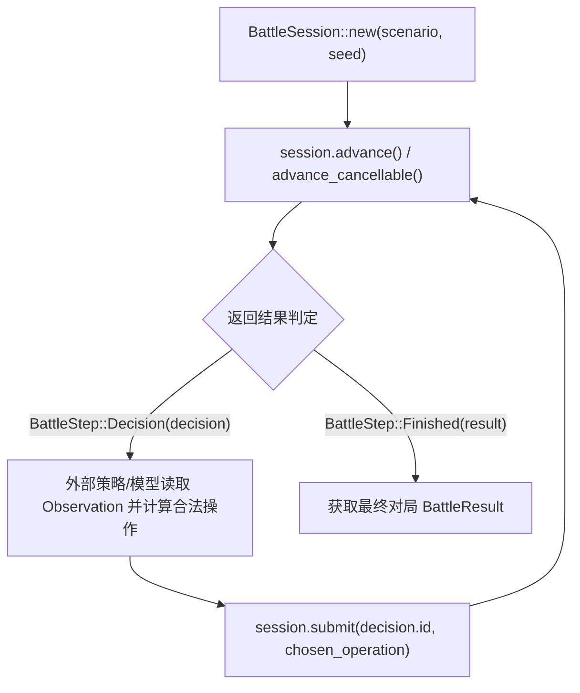

# 外部选招与分步执行 (Stepping & Decision API)

`BattleSession` 是战斗引擎提供给外部决策系统（如强化学习训练、蒙特卡洛树搜索 MCTS、启发式策略及前端交互界面）的核心分步推进接口。

调用方将会话推进到下一个决策点，读取当前观测与合法操作，再提交选择。

---

## 1. 会话生命周期与调用流程



### 核心方法与契约

| 方法签名 | 说明与前置条件 |
| --- | --- |
| [`BattleSession::new(input, seed)`](../../../core/battle/src/engine/session.rs) | 根据纯内存场景配置和随机种子构建独立战斗会话。完成战前初始化并分派 `BattleStart` 与首波事件。 |
| [`BattleSession::with_trace(input, seed, trace)`](../../../core/battle/src/engine/session.rs) | （仅 `diagnostics` 特性）创建支持记录逐事件回放轨迹（trace）的开发会话。 |
| [`advance(&mut self) -> Result<BattleStep, String>`](../../../core/battle/src/engine/session.rs) | 驱动状态机推进至下一个需要外部决策的点，或直到战斗结束。若当前已存在待答复决策，多次调用将安全返回相同决策。 |
| [`advance_cancellable(&mut self, cancel) -> Result<BattleStep, String>`](../../../core/battle/src/engine/session.rs) | 接收 `FnMut() -> bool` 取消检查。在调度边界和等待恢复时检查，取消时返回 `Incomplete/Cancelled` 快照。 |
| [`submit(&mut self, id, choice) -> Result<(), String>`](../../../core/battle/src/engine/session.rs) | 检查决策 ID 和操作，登记插入请求或执行当前回合动作。校验失败时可更正后重试。执行中出错则结束会话，后续调用返回同一错误。 |

---

## 2. 决策类型与观测结构

### 2.1 决策点类型 ([`DecisionPoint`](../../../core/battle/src/decision.rs))

引擎在以下三个时机产出决策点：

1. **`DecisionPoint::NormalTurn`**：单位常规行动回合。必须从 `legal` 动作列表中选取一个合法的操作（如普攻或战技），不可提交 `None`。
2. **`DecisionPoint::ExtraTurn`**：由机制赋予的额外行动回合。同样必须选取一个合法动作，执行后不消耗自然 AV 时间。
3. **`DecisionPoint::Insert`**：行动间隙的终结技插入窗口。调用方可从就绪的终结技列表中提交预插队请求，或提交 `None` 放弃本次插入机会。

### 2.2 局面观测 ([`Observation`](../../../core/battle/src/decision.rs))

决策发生时，调用方可读取以下字段：

- **时钟与轮次**：当前已流逝 AV (`now`)、当前 Cycle 索引、本轮剩余 AV 及对局总剩余 AV 预算。
- **战技点**：我方与敌方当前持有的共享战技点（Skill Points）。
- **行动轴排序**：所有存活单位按行动顺序排列的 [`AxisPosition`](../../../core/battle/src/decision.rs) 列表（包含单位 ID、剩余行动距离、实时速度与等待 AV）。
- **单位快照**：已入场单位的状态，包含阵亡记录，以及生命、护盾、能量、韧性、动态变量、Modifier 和自然/附加弱点。

`legal` 中的 `Operation` 由单位索引和动作索引组成，目标由动作配置和引擎规则决定。

---

## 3. 边界处理与时序保障

### 3.1 终结技排队与能量扣减时机

- 在 `Insert` 决策点提交终结技仅表示将该操作登记入待执行队列。
- 当该终结技真正切入 Turn 获得执行权时，引擎会**二次核对单位存活性与能量资源**，并在触发 `TurnStart` 监听器前扣除能量。
- 切入时若单位已阵亡或资源不足，引擎放弃该请求。

### 3.2 轮次耗尽与回合收尾次序

当战斗的总 AV 预算耗尽或轮次到期时：

1. **已进入回合的收尾**：如果单位已经开始执行当前回合（Turn），该回合内的完整动作、效果及 `TurnEnd` 监听必须完整结算完毕，不会在动作中间被硬截断。
2. **Cycle 结算**：单位回合完全结束后，再处理到期 Cycle 的结算事件。
3. **终局判定**：若上述收尾完成后依然存在存活敌人，判定为战斗超时失败；若动作造成的伤害恰好完成清场，依然判定为战斗胜利。

### 3.3 有限敌人队列补充时机

有限队列在当前 Action 及其即时监听执行完毕后的调度边界，按空槽顺序补入敌人。排队的追加攻击是后续 Action，可以选中新入场敌人。轮次到期且普通回合仍在收尾时，补位先于该回合的 `TurnEnd`。

---

## 4. 调用示例

以下展示通过 Rust 驱动外部选招的基础模板：

```rust
use battle_core::engine::{BattleSession, BattleStep};
use battle_core::model::{BattleResult, Scenario};
use battle_core::decision::{Decision, Operation};

fn run_session_with_custom_policy(
    scenario: &Scenario,
    seed: u64,
) -> Result<BattleResult, String> {
    // 1. 初始化纯内存会话
    let mut battle = BattleSession::new(scenario, seed)?;

    // 2. 分步循环推进
    loop {
        let (id, choice) = match battle.advance()? {
            BattleStep::Decision(decision) => {
                let choice = evaluate_policy(decision);
                (decision.id, choice)
            }
            BattleStep::Finished(result) => {
                // 3. 对局已完成，克隆或消费结果
                return Ok(result.clone());
            }
        };
        // 4. 提交决策选择
        battle.submit(id, choice)?;
    }
}

fn evaluate_policy(decision: &Decision) -> Option<Operation> {
    // 示例简单选择第一个合法操作；对于 Insert 点可返回 None 放弃本次插入
    decision.legal.first().cloned()
}
```

更多可运行的完整示例参见仓库中的 [`step_battle.rs`](../../../core/battle/examples/step_battle.rs)。
