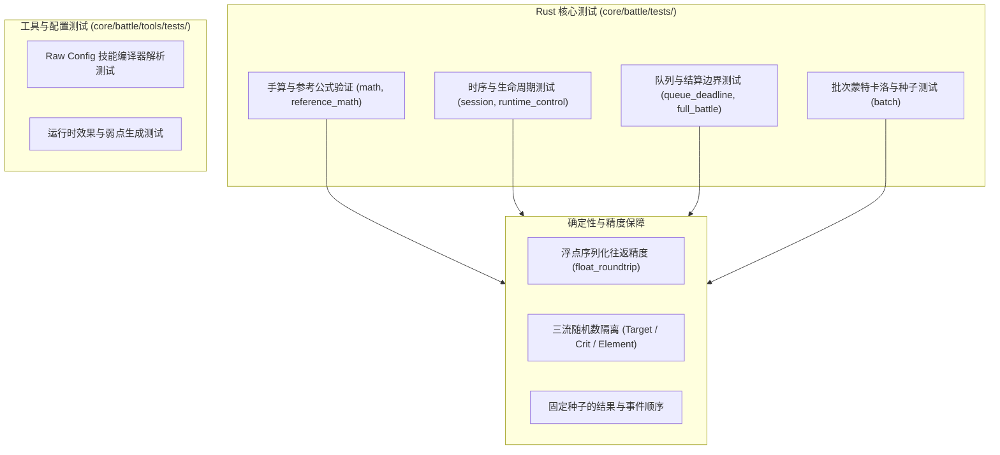

# 战斗模拟验证与测试指南

本文档阐述 `core/battle` 战斗模拟核心的自动化验证体系、测试分层、确定性保障原则以及本地回归执行方式。

---

## 1. 验证体系架构

战斗模块的正确性由多层次测试套件共同保障：



### 测试用例分布

| 测试目录 / 文件 | 覆盖范围与验证要点 |
| --- | --- |
| `tests/reference_math.rs` | 用 18 组参考值核对直接伤害乘区。 |
| `tests/session.rs` | 核对暂停期间重复读取、拒绝过期 ID 和非法操作、终结技扣能、取消及回合收尾顺序。 |
| `tests/queue_deadline.rs` | 覆盖有限敌人队列与轮次耗尽边界：动作彻底完成后补位、超时快照保全、同刻 Cycle 结算次序。 |
| `tests/runtime_control.rs`、`tests/dynamic_scopes.rs` | 核对条件分支、循环次数上限、动作内目标绑定和调用帧变量隔离。 |
| `tests/property_modifiers.rs` | 覆盖状态（Modifier）生命周期：叠层上限、按来源独立叠加、回合到期扣减、即时监听修改后续同 Action 命中数值。 |
| `tests/batch.rs` | 核对种子派生参考值、逐场复现、已完成场次的胜负统计、取消与 95% Wilson 区间。 |
| `tools/tests/` | 核对开发用原始配置转换、表达式解析、效果和弱点转换及那刻夏场景构建。 |

---

## 2. 确定性与回归原则

固定场景、种子与操作序列后，可按以下规则核对模拟结果：

1. **三流随机数隔离 (Three Independent RNG Streams)**：
   - 每场战斗基于单一输入种子，通过 `rand_chacha` 派生三条完全独立的伪随机数流：**目标选择流**、**暴击判定流**、**元素选择流**。
   - 各类抽样各自推进随机流。同一流上的抽样次数仍取决于实际执行路径。
2. **64 位种子无损传输**：
   - 随机种子在 Rust 内部为 `u64`。
   - 在 JSON 格式中序列化为十进制字符串（如 `"18446744073709551615"`），防止外部语言或前端运行时解析为 JavaScript Number 时发生精度截断。
3. **浮点往返序列化一致性**：
   - 开发 JSON 使用 `serde_json` 的 `float_roundtrip` 特性。场景指纹基于解析后重新序列化的完整 JSON，包含开发元数据。
4. **单局与批次对齐**：
   - 用批次摘要里的派生种子重新运行同一场景，可比对完成场次的胜负、终止原因、AV 和动作数。逐事件回放由单局 `simulate` 输出。

---

## 3. 本地验证执行方式

### 3.1 核心 Rust 测试与代码质量检查

在仓库根目录下运行：

```powershell
# 1. 运行默认构建的核心流程测试
cargo test -p battle-core --locked

# 2. 运行含 diagnostics 的战斗测试
cargo test -p battle-core --all-features --locked

# 3. 执行严格静态代码检查（禁止任何 Warning）
cargo clippy -p battle-core --all-targets --all-features --locked -- -D warnings

# 4. 检查代码格式
cargo fmt --all -- --check
```

### 3.2 Python 配置与工具测试

在 `core/battle/` 目录下运行：

```powershell
python -m unittest discover -s tools/tests -t . -p "test_*.py"
```

### 3.3 示例场景对照与冒烟测试

使用内建的四个基础场景运行单局与批次模拟（需开启 `diagnostics` 特性），确认无 Panic 与非正常退出：

```powershell
cargo run -p battle-core --features diagnostics --bin hcwa-battle --release --locked -- simulate core/battle/examples/duel.json 42
cargo run -p battle-core --features diagnostics --bin hcwa-battle --release --locked -- simulate core/battle/examples/team-waves.json 42
cargo run -p battle-core --features diagnostics --bin hcwa-battle --release --locked -- simulate core/battle/examples/revival-budget.json 42
cargo run -p battle-core --features diagnostics --bin hcwa-battle --release --locked -- simulate core/battle/examples/anaxa-s2-full-battle.json 42

cargo run -p battle-core --features diagnostics --bin hcwa-battle --release --locked -- batch core/battle/examples/duel.json 100 42
```

### 那刻夏 S2 样例

[`anaxa-s2-full-battle.json`](../../../core/battle/examples/anaxa-s2-full-battle.json) 在种子 42 下返回 `victory / enemies_defeated`。场上容量为 2，最终清空 6 名敌人，执行 40 个 Action，消耗 1250 AV，剩余约 1150 AV。样例诊断 `settlement.hp_after` 为 63。

## 4. 实机核对

当前验证覆盖人工场景和参考公式。那刻夏样例的资料版本、近似规则和覆盖范围见场景的 `provenance` 与 `mechanics.assumptions`，技能链、队列补位和轮次同刻顺序待按实机样本核对。

以一场连续录像为单位，记录游戏版本、赛季、关卡和难度。保留实际阵容、装备、战前有效面板、初始能量和战技点、各轮 AV、敌人入场顺序及操作序列。将击中、回能、追击、补位、复活罚时和终止时点与模拟事件逐项对照。节点结算按[项目验证计划](../../project/roadmap.md#战斗与节点结算核对)采样。
